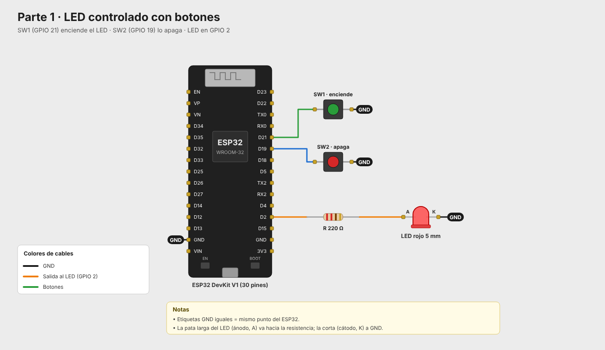
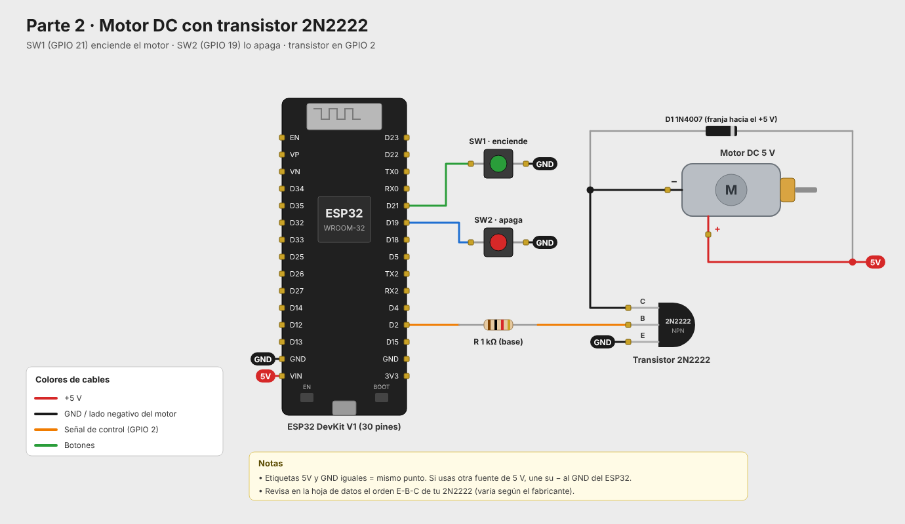
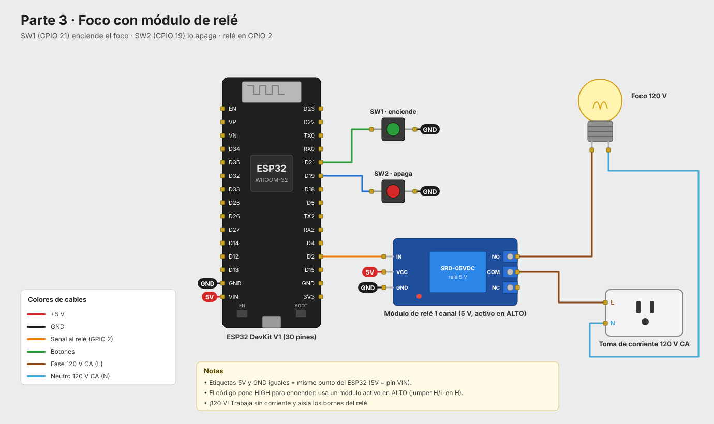

# Control de salidas digitales con botones: LED, motor DC y foco

Práctica en tres partes con el mismo principio: dos botones controlan una salida digital del ESP32. **SW1 enciende** la salida y **SW2 la apaga**. En cada parte cambia lo que se controla y la etapa de potencia que se necesita.

| Parte | Carpeta | Salida | Etapa de potencia |
|---|---|---|---|
| 1 | `parte1_led/` | LED | Resistencia de 220 Ω |
| 2 | `parte2_motor_dc/` | Motor DC de 5 V | Transistor 2N2222 |
| 3 | `parte3_foco_rele/` | Foco de 120 V | Módulo de relé |

## Pines (iguales en las tres partes)

| Elemento | ESP32 |
|---|---|
| Salida (LED, motor o relé) | GPIO 2 |
| SW1 (enciende) | GPIO 21 y GND |
| SW2 (apaga) | GPIO 19 y GND |

Los botones usan las resistencias pull-up internas del ESP32 (`INPUT_PULLUP`), así que se leen como `0` al presionarse. El monitor serie (115200 baudios) indica cada vez que se enciende o apaga la salida.

## Parte 1: LED

El GPIO 2 alimenta directamente un LED a través de una resistencia de 220 Ω. La pata larga (ánodo) va hacia la resistencia y la corta (cátodo) a GND.



## Parte 2: Motor DC con transistor 2N2222

Un pin del ESP32 no entrega suficiente corriente para un motor, así que el GPIO 2 controla la base de un transistor 2N2222 a través de una resistencia de 1 kΩ. El transistor funciona como interruptor del lado negativo del motor:

- **Base:** GPIO 2 a través de la resistencia de 1 kΩ
- **Colector:** terminal − del motor
- **Emisor:** GND
- **Terminal + del motor:** 5 V
- **Diodo 1N4007** en paralelo con el motor, con la franja hacia el +5 V, para proteger al transistor del pico de voltaje que genera el motor al apagarse.

El orden de las patas E-B-C del 2N2222 cambia según el fabricante, así que conviene revisarlo en su hoja de datos.



## Parte 3: Foco con módulo de relé

El GPIO 2 activa un módulo de relé de 1 canal que conmuta el foco de 120 V. El código enciende con `HIGH`, así que el módulo debe ser **activo en alto** (jumper H/L en H).

- **Módulo de relé:** IN → GPIO 2, VCC → 5V (VIN), GND → GND
- **Foco:** la fase de la toma va al COM del relé, el NO va al foco y el neutro va directo a la otra terminal del foco.

> ⚠️ El foco trabaja a 120 V. Haz las conexiones sin corriente y aísla los bornes del relé.



## Estructura

```
practica_led_foco_motor/
├── parte1_led/
├── parte2_motor_dc/
└── parte3_foco_rele/
```

Cada parte contiene:

```
├── src/main.cpp          Código del programa
├── platformio.ini        Configuración de PlatformIO
├── diagram.json          Circuito para el simulador Wokwi
├── wokwi.toml            Configuración de Wokwi
├── libraries.txt         Librerías para Wokwi (no se usan librerías externas)
└── docs/                 Diagrama de conexiones (PNG y SVG)
```

## Cómo compilar y cargar

**PlatformIO (VS Code):** abre la carpeta de la parte que quieras, compila con *Build* y carga con *Upload*.

**Arduino IDE:** copia el contenido de `src/main.cpp` a un sketch `.ino` y selecciona la placa **ESP32 Dev Module**. No se necesitan librerías adicionales.

**Simulación en Wokwi:** compila con PlatformIO y abre el simulador desde la extensión de Wokwi. Wokwi no tiene motor DC ni transistor, y su módulo de relé no es confiable para esta prueba, así que en las tres partes la salida se representa con un LED.

## Nota

El GPIO 2 es un pin de arranque del ESP32. Si al cargar un programa aparece un error de conexión, desconecta temporalmente lo que esté conectado a ese pin y vuelve a intentarlo.
