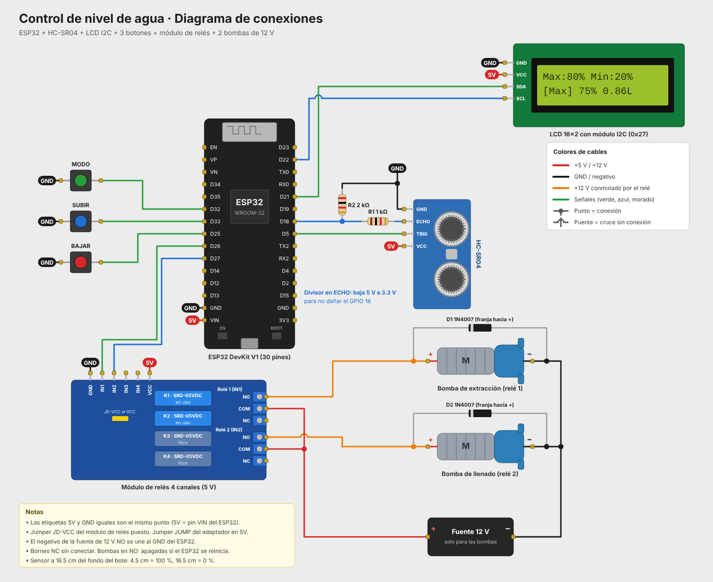

# Control de nivel de agua con ESP32

Sistema que mantiene el nivel de agua de un bote en un ciclo continuo de **llenado y vaciado** entre un porcentaje máximo y uno mínimo, ambos ajustables con botones. El nivel se mide con un sensor ultrasónico HC-SR04 y se muestra en una pantalla LCD 16x2.

## Funcionamiento

1. **Llenando:** la bomba de llenado (relé 2) trabaja hasta que el nivel llega al **máximo** (80 % por defecto).
2. Al llegar al máximo se apaga y se enciende la **bomba de extracción** (relé 1).
3. **Vaciando:** la bomba de extracción trabaja hasta que el nivel baja al **mínimo** (20 % por defecto).
4. Al llegar al mínimo vuelve a llenar, y el ciclo se repite.

Además:

- Las dos bombas nunca están encendidas al mismo tiempo. Al cambiar de una a otra hay una pausa de 1 s con ambas apagadas.
- Si el sensor deja de responder unos 2 s, se apagan las dos bombas y la LCD muestra `Error sensor`.
- Los límites se guardan en la memoria del ESP32 (`Preferences`) y se conservan aunque se vaya la luz.

### Botones

| Botón | Función |
|---|---|
| MODO | Cambia entre editar el máximo y el mínimo |
| SUBIR | Sube 1 % el valor seleccionado |
| BAJAR | Baja 1 % el valor seleccionado |

El máximo y el mínimo siempre quedan separados por al menos 10 %.

### Pantalla LCD

```
Max:80% Min:20%
[Max]  75% 0.86L
```

La primera fila muestra los límites. La segunda muestra el modo que se está editando, el porcentaje actual y los litros.

## Calibración del bote

| Medida | Valor |
|---|---|
| Altura del bote | 17 cm |
| Diámetro | 11 cm |
| Altura del sensor (desde el fondo) | 16.5 cm |
| 100 % de llenado | agua a 12 cm → sensor mide 4.5 cm |
| 0 % de llenado | fondo → sensor mide 16.5 cm |
| Volumen al 100 % | ≈ 1.14 L |

Cada 1 % equivale a 1.2 mm de agua. Para otro recipiente, cambia las constantes `ALTURA_SENSOR_CM`, `ALTURA_AGUA_LLENO_CM` y `DIAMETRO_BOTE_CM` en `src/main.cpp`.

## Componentes

- ESP32 DevKit V1 (30 pines) con base de expansión
- Sensor ultrasónico HC-SR04
- Resistencias de 1 kΩ y 2 kΩ (divisor de voltaje para ECHO)
- Pantalla LCD 16x2 con módulo I2C (dirección 0x27)
- 3 botones pulsadores
- Módulo de relés de 4 canales (5 V, activo en bajo)
- 2 bombas de agua de diafragma de 12 V
- 2 diodos 1N4007
- Fuente de 12 V para las bombas

## Conexiones

| Componente | Pin | ESP32 |
|---|---|---|
| HC-SR04 | TRIG | GPIO 5 |
| HC-SR04 | ECHO (con divisor 1 kΩ / 2 kΩ) | GPIO 18 |
| HC-SR04 | VCC / GND | 5V (VIN) / GND |
| Relé 1 (bomba de extracción) | IN1 | GPIO 26 |
| Relé 2 (bomba de llenado) | IN2 | GPIO 27 |
| Botón MODO | — | GPIO 32 y GND |
| Botón SUBIR | — | GPIO 33 y GND |
| Botón BAJAR | — | GPIO 25 y GND |
| LCD I2C | SDA / SCL | GPIO 21 / GPIO 22 |
| LCD I2C | VCC / GND | 5V (VIN) / GND |

**Lado de potencia (12 V):** el + de la fuente va al **COM** de cada relé, y el **NO** de cada relé va al + de su bomba. Los negativos de las bombas van directo al − de la fuente. Cada bomba lleva un diodo 1N4007 en paralelo, con la franja hacia el +.



## Estructura

```
control_nivel_agua/
├── src/main.cpp          Código del programa
├── platformio.ini        Configuración de PlatformIO
├── diagram.json          Circuito para el simulador Wokwi
├── wokwi.toml            Configuración de Wokwi
├── libraries.txt         Librerías para Wokwi
└── docs/                 Diagrama de conexiones (PNG y SVG)
```

## Cómo compilar y cargar

**PlatformIO (VS Code):** abre esta carpeta, compila con *Build* y carga con *Upload*. La librería se descarga sola desde `platformio.ini`. El monitor serie trabaja a 115200 baudios.

**Arduino IDE:** copia el contenido de `src/main.cpp` a un sketch `.ino`, instala la librería **LiquidCrystal I2C** (Frank de Brabander) y selecciona la placa **ESP32 Dev Module**.

**Simulación en Wokwi:** compila con PlatformIO y abre el simulador desde la extensión de Wokwi. Haz clic en el HC-SR04 para cambiar la distancia y ver cómo responde el ciclo. En la simulación, las bombas se representan con LEDs que se encienden cuando su relé estaría activado.

## Notas

- El pin ECHO del HC-SR04 entrega 5 V y el ESP32 solo tolera 3.3 V, así que el divisor de voltaje es necesario.
- El negativo de la fuente de 12 V no se une al GND del ESP32: los relés aíslan los dos circuitos.
- Las bombas van en los bornes **NO**, así quedan apagadas si el ESP32 se reinicia.
- El jumper JD-VCC del módulo de relés va puesto y el jumper JUMP de la base de expansión en 5V.
