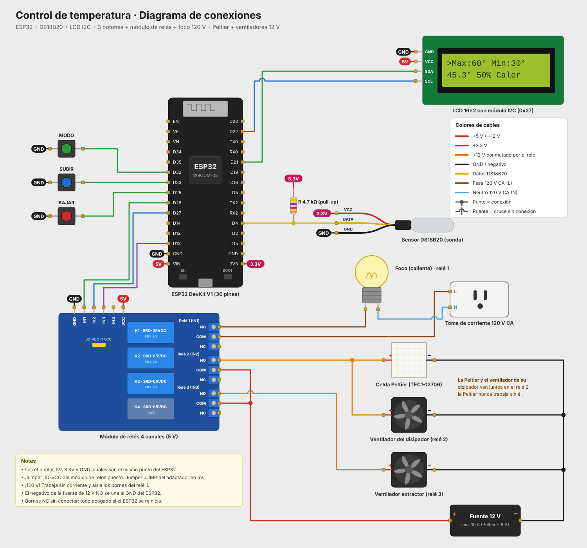

# Control ON-OFF de temperatura con ESP32

Sistema que mantiene la temperatura de una caja en un ciclo continuo de **calentamiento y enfriamiento** entre una temperatura máxima y una mínima, ambas ajustables con botones. Un foco calienta la caja, una celda Peltier la enfría y un sensor DS18B20 mide la temperatura.

## Funcionamiento

1. **Calentando:** el foco (relé 1) está encendido hasta que la temperatura llega al **máximo** (60 °C por defecto).
2. Al llegar al máximo se apaga el foco y se encienden la **celda Peltier con su ventilador** (relé 2) y el **ventilador extractor** (relé 3).
3. **Enfriando:** la Peltier y el extractor trabajan hasta que la temperatura baja al **mínimo** (30 °C por defecto).
4. Al llegar al mínimo se apagan y vuelve a encender el foco, y el ciclo se repite.

Además:

- El extractor solo trabaja durante el enfriamiento. Al calentar está apagado para no sacar el calor del foco.
- El foco y la Peltier nunca están encendidos al mismo tiempo. Al cambiar de uno a otro hay una pausa de 1 s con ambos apagados.
- Si el sensor deja de responder, se apagan el foco y la Peltier, y la LCD muestra `Error sensor`.
- Los límites se guardan en la memoria del ESP32 (`Preferences`).
- La lectura del DS18B20 no bloquea el programa, así que los botones responden mientras mide.

### Botones

| Botón | Función |
|---|---|
| MODO | Cambia entre editar el máximo y el mínimo |
| SUBIR | Sube 1 °C el valor seleccionado |
| BAJAR | Baja 1 °C el valor seleccionado |

Los límites se pueden ajustar entre 0 °C y 99 °C, separados por al menos 5 °C.

### Pantalla LCD

```
>Max:60° Min:30°
45.3°  50% Calor
```

La flecha `>` marca el límite que se está editando. La segunda fila muestra la temperatura actual, el porcentaje y el estado (`Calor` o `Frio`). El porcentaje indica dónde está la temperatura entre el mínimo (0 %) y el máximo (100 %).

## Componentes

- ESP32 DevKit V1 (30 pines) con base de expansión
- Sensor de temperatura DS18B20 y resistencia de 4.7 kΩ (pull-up)
- Pantalla LCD 16x2 con módulo I2C (dirección 0x27)
- 3 botones pulsadores
- Módulo de relés de 4 canales (5 V, activo en bajo)
- Foco incandescente de 120 V con soquet
- Celda Peltier TEC1-12706 con disipador y ventilador
- Ventilador extractor de 12 V
- Fuente de 12 V (mínimo 10 A, la Peltier consume ≈ 6 A)

## Conexiones

| Componente | Pin | ESP32 |
|---|---|---|
| DS18B20 | DATA (con 4.7 kΩ a 3.3 V) | GPIO 4 |
| DS18B20 | VCC / GND | 3.3 V / GND |
| Relé 1 (foco) | IN1 | GPIO 26 |
| Relé 2 (Peltier + su ventilador) | IN2 | GPIO 27 |
| Relé 3 (extractor) | IN3 | GPIO 13 |
| Botón MODO | — | GPIO 32 y GND |
| Botón SUBIR | — | GPIO 33 y GND |
| Botón BAJAR | — | GPIO 25 y GND |
| LCD I2C | SDA / SCL | GPIO 21 / GPIO 22 |
| LCD I2C | VCC / GND | 5V (VIN) / GND |

**Lado de potencia:**

- **Foco (120 V):** la fase de la toma va al COM del relé 1, el NO va al foco y el neutro va directo a la otra terminal del foco.
- **12 V:** el + de la fuente va al COM de los relés 2 y 3. El NO del relé 2 alimenta a la Peltier y al ventilador de su disipador en paralelo, y el NO del relé 3 al extractor. Los negativos van al − de la fuente.



## Estructura

```
control_temperatura/
├── src/main.cpp          Código del programa
├── platformio.ini        Configuración de PlatformIO
├── diagram.json          Circuito para el simulador Wokwi
├── wokwi.toml            Configuración de Wokwi
├── libraries.txt         Librerías para Wokwi
└── docs/                 Diagrama de conexiones (PNG y SVG)
```

## Cómo compilar y cargar

**PlatformIO (VS Code):** abre esta carpeta, compila con *Build* y carga con *Upload*. Las librerías se descargan solas desde `platformio.ini`. El monitor serie trabaja a 115200 baudios.

**Arduino IDE:** copia el contenido de `src/main.cpp` a un sketch `.ino` e instala las librerías **LiquidCrystal I2C** (Frank de Brabander), **OneWire** (Paul Stoffregen) y **DallasTemperature** (Miles Burton). Selecciona la placa **ESP32 Dev Module**.

**Simulación en Wokwi:** compila con PlatformIO y abre el simulador desde la extensión de Wokwi. Haz clic en el DS18B20 y mueve el control deslizante para cambiar la temperatura. En la simulación, el foco, la Peltier y el extractor se representan con LEDs que se encienden cuando su relé estaría activado.

## Notas de seguridad

- El foco trabaja a **120 V**. Haz las conexiones sin corriente y aísla los bornes del relé 1.
- La Peltier nunca debe encenderse sin su disipador y ventilador: se quema en segundos. Por eso los dos van en el mismo relé.
- El lado caliente de la Peltier va **fuera** de la caja y el lado frío **dentro**.
- El negativo de la fuente de 12 V no se une al GND del ESP32.
