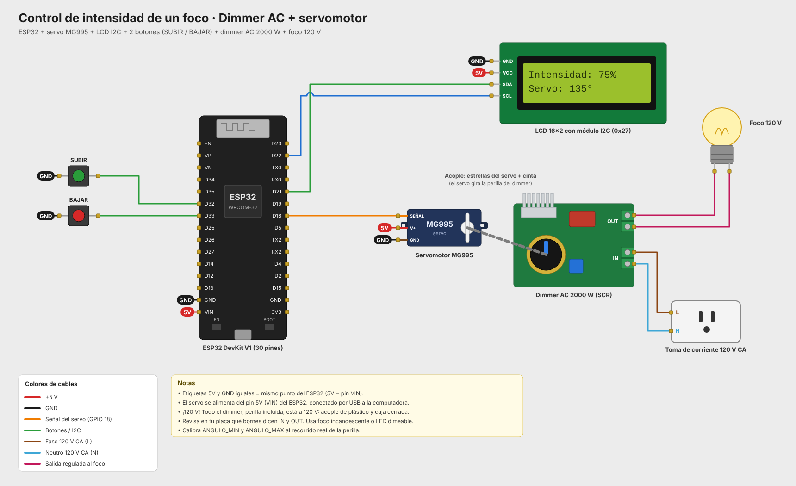

# Control de intensidad de un foco con dimmer AC y servomotor

Un servomotor MG995 gira la perilla de un módulo **dimmer AC de 2000 W** para regular la intensidad de un foco de 120 V. El ESP32 mueve el servo con dos botones y una pantalla LCD 16x2 muestra el porcentaje de intensidad y los grados del servo.

## Funcionamiento

- **SUBIR** gira el servo para aumentar la intensidad y **BAJAR** para disminuirla, 3° por pulsación.
- Si se mantiene presionado un botón, el servo sigue moviéndose solo (repetición automática).
- La posición se guarda en la memoria del ESP32 (`Preferences`). Al encender de nuevo, el servo regresa a donde estaba, sin dar un giro brusco.
- El monitor serie (115200 baudios) muestra el ángulo y el porcentaje de intensidad.

### Pantalla LCD

```
Intensidad:  75%
Servo:     135°
```

## Acople mecánico

Una estrella del servo se adaptó al potenciómetro del dimmer y se pegó a otra estrella colocada en el eje del servo. Así, al girar el servo también gira el potenciómetro. Ambas se fijaron con cinta para dar más estabilidad.

## Componentes

- ESP32 DevKit V1 (30 pines) con base de expansión
- Servomotor MG995
- Módulo dimmer AC de 2000 W (SCR)
- Foco incandescente con soquet y cable con clavija
- Pantalla LCD 16x2 con módulo I2C (dirección 0x27)
- 2 botones pulsadores

## Conexiones

| Componente | Pin | ESP32 |
|---|---|---|
| Servo MG995 | Señal (naranja) | GPIO 18 |
| Servo MG995 | V+ (rojo) / GND (café) | 5V (VIN) / GND |
| Botón SUBIR | — | GPIO 32 y GND |
| Botón BAJAR | — | GPIO 33 y GND |
| LCD I2C | SDA / SCL | GPIO 21 / GPIO 22 |
| LCD I2C | VCC / GND | 5V (VIN) / GND |

**Lado de 120 V:** la entrada del dimmer (*IN*) va a la toma de corriente y la salida (*OUT*) al foco. Revisa en la placa qué bornes son IN y OUT, porque cambia según la versión del módulo.

El servo se alimenta del pin 5V del ESP32, que a su vez se alimenta por USB. Si el servo se fuerza mucho y el ESP32 se reinicia, conviene usar una fuente aparte de 5–6 V y unir su GND con el del ESP32.



## Calibración

En `src/main.cpp`:

- `ANGULO_MIN` / `ANGULO_MAX`: ajústalos al recorrido real de la perilla, para que el servo no se fuerce contra los topes del potenciómetro.
- `INVERTIR_SENTIDO`: cámbialo a `true` si al presionar SUBIR el foco baja de intensidad.
- `PASO_GRADOS`: grados que se mueve el servo por pulsación.

## Estructura

```
control_dimmer_servo/
├── src/main.cpp          Código del programa
├── platformio.ini        Configuración de PlatformIO
├── diagram.json          Circuito para el simulador Wokwi
├── wokwi.toml            Configuración de Wokwi
├── libraries.txt         Librerías para Wokwi
└── docs/                 Diagrama de conexiones (PNG y SVG)
```

## Cómo compilar y cargar

**PlatformIO (VS Code):** abre esta carpeta, compila con *Build* y carga con *Upload*. Las librerías se descargan solas desde `platformio.ini`.

**Arduino IDE:** copia el contenido de `src/main.cpp` a un sketch `.ino` e instala las librerías **ESP32Servo** (Kevin Harrington, John K. Bennett) y **LiquidCrystal I2C** (Frank de Brabander). Selecciona la placa **ESP32 Dev Module**. La librería `Servo.h` normal de Arduino no funciona con el ESP32.

**Simulación en Wokwi:** compila con PlatformIO y abre el simulador desde la extensión de Wokwi. Wokwi no tiene dimmer ni foco de 120 V, así que en la simulación solo se ve girar el servo y cambiar la LCD.

## Notas de seguridad

- **Todo el dimmer está a 120 V, incluido el potenciómetro y la parte de abajo de la placa.** Durante la práctica, un integrante recibió un toque al sujetar el módulo por debajo. Manipúlalo solo desconectado y, de preferencia, dentro de una caja.
- Une el servo a la perilla solo con piezas de plástico, nunca con metal.
- Usa un foco incandescente o un LED que diga "dimeable". Los focos LED normales parpadean con este tipo de dimmer.
