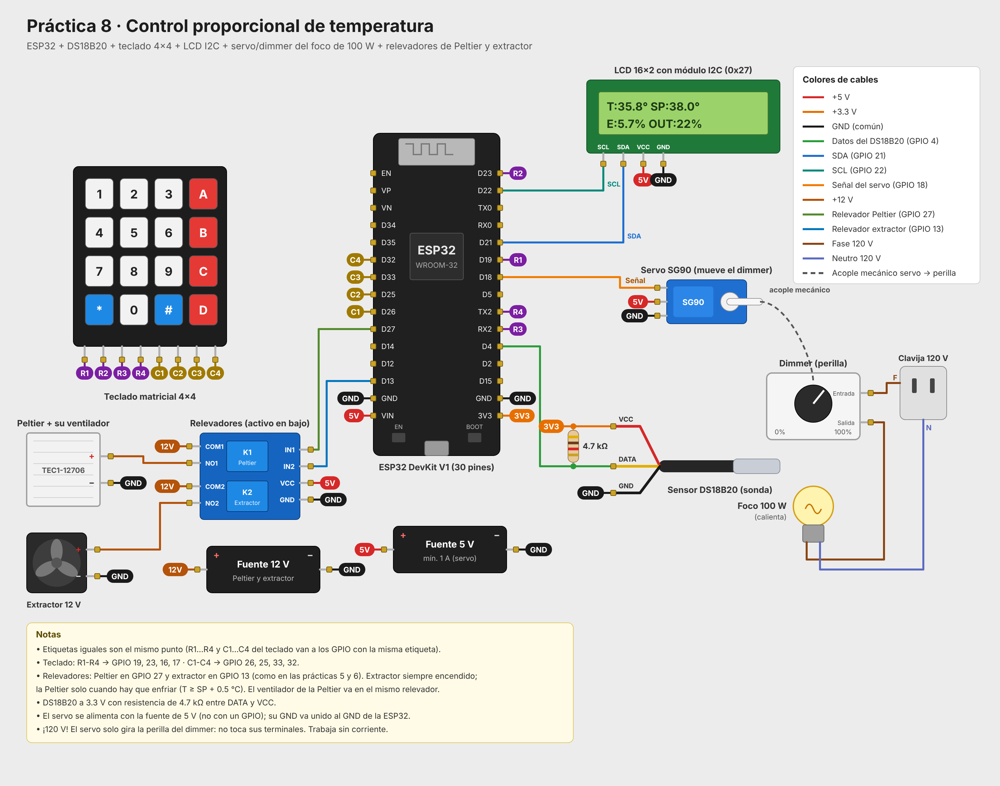
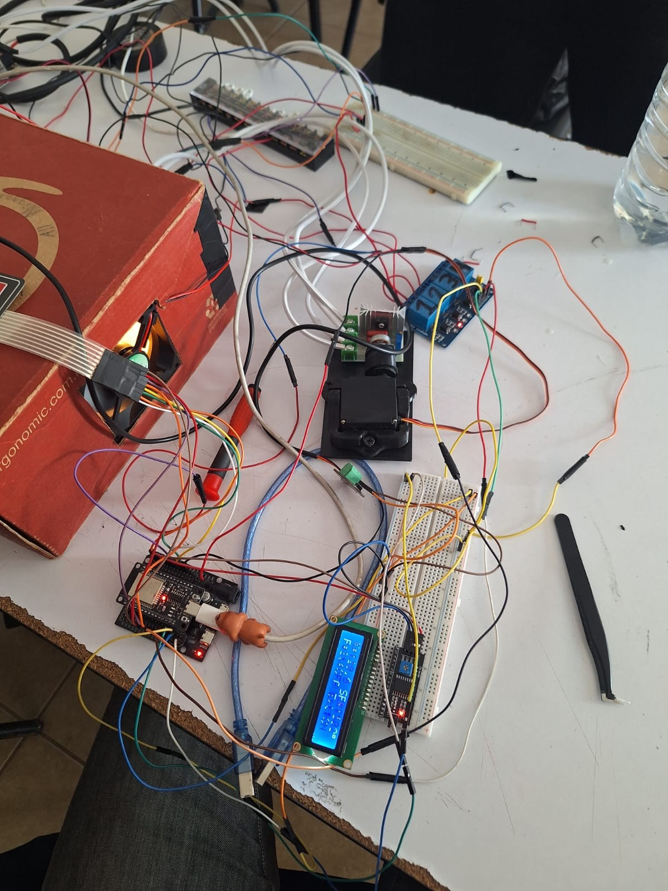
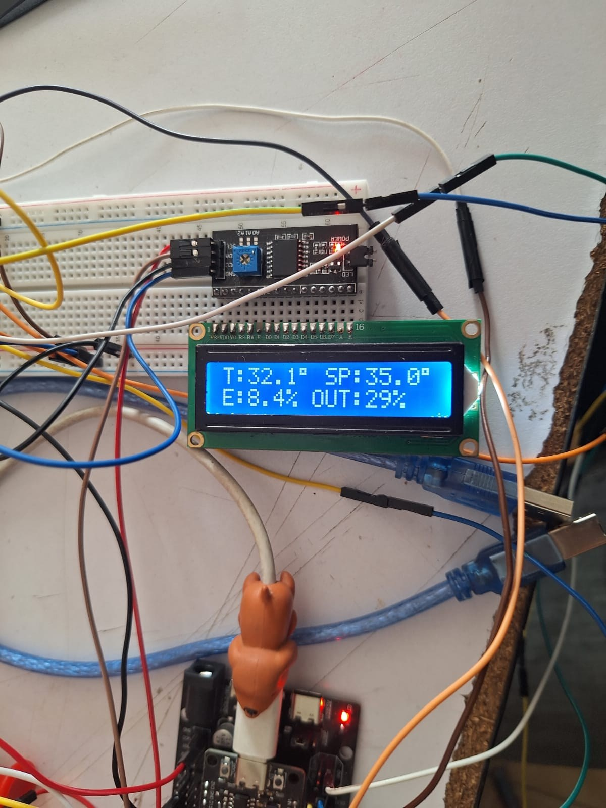

# Práctica 8: Control proporcional de temperatura

Control **proporcional (P)** de temperatura con un **ESP32**:

- un sensor **DS18B20** mide la temperatura;
- con un **teclado 4x4** se fijan la temperatura de referencia (SP, de 35 a 40 °C) y la ganancia Kp;
- una **LCD I2C** muestra las variables;
- un **servo** gira la perilla de un **dimmer**, que regula la potencia de un foco de 100 W (calienta);
- un **módulo de relevadores** maneja la **celda Peltier** (enfría) y el **extractor**, igual que en las prácticas anteriores.

A diferencia del control ON-OFF, la potencia del foco cambia poco a poco según qué tan lejos está la temperatura de la referencia.

## Funcionamiento

Cada segundo (Ts = 1 s) el ESP32:

1. Lee la temperatura T del DS18B20.
2. Calcula el error: **e = SP − T**, y también en porcentaje del SP: **e% = e / SP · 100**.
3. Calcula la salida del foco: **u = Kp · e**, limitada de 0 a 100 %. Un error negativo da 0 %.
4. Convierte la salida en un ángulo para el servo:

   $$\theta = \theta_{min} + \frac{u}{100}(\theta_{max} - \theta_{min})$$

   con θmin = 90° (dimmer al mínimo) y θmax = 180° (dimmer al máximo).
5. Mueve el servo, que gira la perilla del dimmer.
6. Revisa si hace falta enfriar y maneja los relevadores.

Ejemplo con SP = 38 °C y Kp = 10 %/°C:

| T | Error | Error % | Salida | Ángulo |
|---|---|---|---|---|
| 30 °C | 8 °C | 21.1 % | 80 % | 162° |
| 35 °C | 3 °C | 7.9 % | 30 % | 117° |
| 38 °C | 0 °C | 0 % | 0 % | 90° |

Como la salida vale 0 cuando el error es 0, el control P se estabiliza **un poco abajo** del setpoint. Ese es el error en estado estable, y disminuye al subir Kp.

### Peltier y extractor

| Relevador | Cuándo se enciende |
|---|---|
| **Extractor** | Siempre, mientras el sistema está funcionando |
| **Peltier** | Solo cuando hay que enfriar: se enciende si T ≥ SP + 0.5 °C y se apaga cuando T baja al SP |

Mientras la Peltier enfría, el foco se queda al mínimo (servo en 90°) para que no trabajen uno contra el otro. Así el foco sube o baja su potencia y la Peltier solo entra cuando la temperatura se pasa de la referencia.

Si se quiere que el extractor solo funcione junto con la Peltier, se cambia `EXTRACTOR_SIEMPRE` a `false`.

**Seguridad:**
- si el DS18B20 falla, el foco queda al mínimo, la Peltier se apaga y la LCD muestra `Error DS18B20`;
- arriba de 60 °C, el foco se apaga y se enciende la Peltier.

### Teclado

| Tecla | Función |
|---|---|
| **A** | Capturar la temperatura de referencia (35 a 40 °C) |
| **B** | Capturar Kp (0 a 50 %/°C) |
| **0–9** | Escribir el valor |
| **\*** | Punto decimal al capturar. **Sin capturar, cambia de pantalla** |
| **#** | Confirmar |
| **C** | Borrar lo escrito |
| **D** | Cancelar |

Ejemplo: `A 3 6 * 5 #` → SP = 36.5 °C · `B 7 * 5 #` → Kp = 7.5.

### Pantalla LCD

Con la tecla **\*** se cambia entre dos pantallas:

```
Pantalla 1             Pantalla 2
T:35.8° SP:38.0°       Kp:10.0 SER:110°
E:5.7% OUT:22%         Pelt:OFF Ext:ON
```

- **T / SP:** temperatura actual y de referencia.
- **E:** error en porcentaje del SP.
- **OUT:** porcentaje de potencia del foco.
- **Kp:** ganancia proporcional.
- **SER:** grados del servo.
- **Pelt / Ext:** estado de los relevadores de la Peltier y el extractor.

### Monitor serie

A 115200 baudios imprime cada segundo `t, T, SP, error, error_pct, salida, angulo, peltier`, separados por comas. Puedes copiar estos datos a Excel o MATLAB para graficar la respuesta.

## Componentes

- ESP32 DevKit V1 (30 pines)
- Sensor DS18B20 (sonda) y resistencia de 4.7 kΩ
- Teclado matricial 4x4
- Pantalla LCD 16x2 con módulo I2C (0x27)
- Servomotor SG90 o de más torque
- Dimmer compatible con el foco
- Foco de 100 W con soquet
- Módulo de relevadores de 5 V (activo en bajo)
- Celda Peltier TEC1-12706 con disipador y ventilador
- Extractor de 12 V
- Fuente de 12 V para la Peltier y el extractor
- Fuente de 5 V (mínimo 1 A) para el servo

## Conexiones

| Componente | Pin | ESP32 |
|---|---|---|
| DS18B20 | DATA (con 4.7 kΩ a VCC) | GPIO 4 |
| DS18B20 | VCC / GND | 3.3V / GND |
| Teclado | R1, R2, R3, R4 | GPIO 19, 23, 16, 17 |
| Teclado | C1, C2, C3, C4 | GPIO 26, 25, 33, 32 |
| LCD I2C | SDA / SCL | GPIO 21 / GPIO 22 |
| LCD I2C | VCC / GND | 5V / GND |
| Servo | Señal | GPIO 18 |
| Servo | V+ / GND | Fuente de 5 V / GND común |
| Relevador Peltier | IN | GPIO 27 |
| Relevador extractor | IN | GPIO 13 |
| Módulo de relevadores | VCC / GND | 5V / GND |
| Relevadores | COM / NO | +12 V / + de la Peltier y + del extractor |

Los relevadores usan los mismos pines que en las prácticas 5 y 6 (GPIO 27 Peltier, GPIO 13 extractor). Por eso, las filas del teclado pasaron a GPIO 19, 23, 16 y 17.



## Prototipo

<p align="center">
   
</p>

## Estructura

```
practica8_control_proporcional/
├── src/main.cpp          Código del programa
├── platformio.ini        Configuración de PlatformIO
├── diagram.json          Circuito para el simulador Wokwi
├── wokwi.toml            Configuración de Wokwi
├── libraries.txt         Librerías para Wokwi
├── img/                  Diagrama de conexiones y fotos del prototipo
└── doc/                  Reporte de la práctica
```

## Cómo compilar y cargar

**PlatformIO (VS Code):** abre esta carpeta, compila con *Build* y carga con *Upload*. Las librerías se descargan solas desde `platformio.ini`.

**Arduino IDE:** usa el archivo `.ino`, instala las librerías **LiquidCrystal I2C**, **Keypad**, **OneWire**, **DallasTemperature** y **ESP32Servo**, y selecciona la placa **ESP32 Dev Module**.

**Simulación en Wokwi:** haz clic en el DS18B20 para cambiar la temperatura. No hay dimmer ni foco: solo se ve el movimiento del servo. Los relevadores se representan con LEDs, el azul para la Peltier y el verde para el extractor.

## Notas

- **Calibra θmin y θmax** (`ANGULO_MIN` (90°) y `ANGULO_MAX` (180°) en el código) según el recorrido real de la perilla del dimmer. La relación entre ángulo y potencia puede no ser lineal.
- **El SG90 puede quedarse corto** si la perilla está dura. En ese caso usa un servo de más torque, como el MG995.
- **Relevadores:** el código supone un módulo activo en bajo. Si encienden al revés, intercambia `LOW` y `HIGH` en `RELE_ON` y `RELE_OFF`.
- **¡120 V!** El servo solo gira la perilla, no toca los terminales del dimmer. Haz las conexiones sin corriente.
