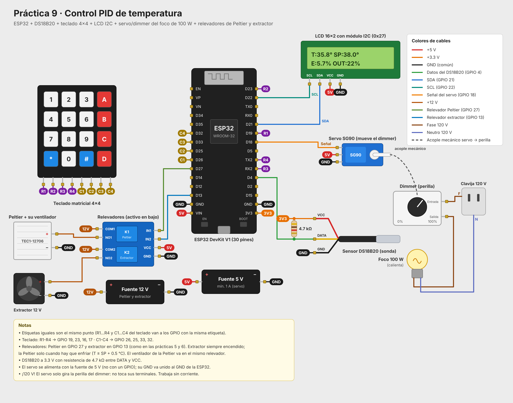
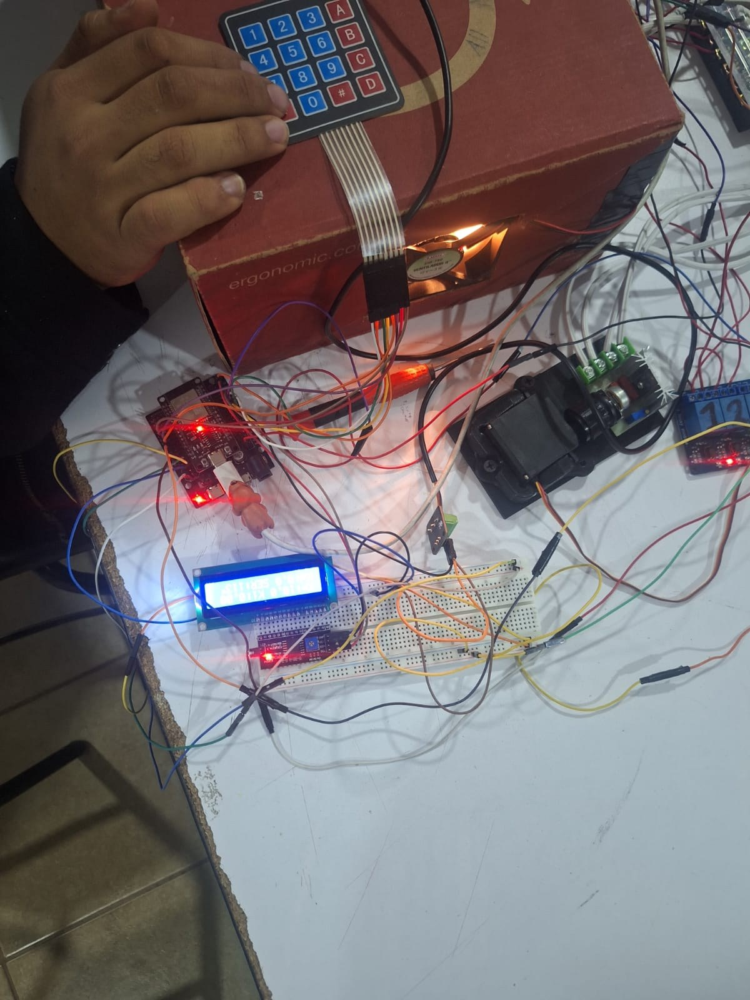
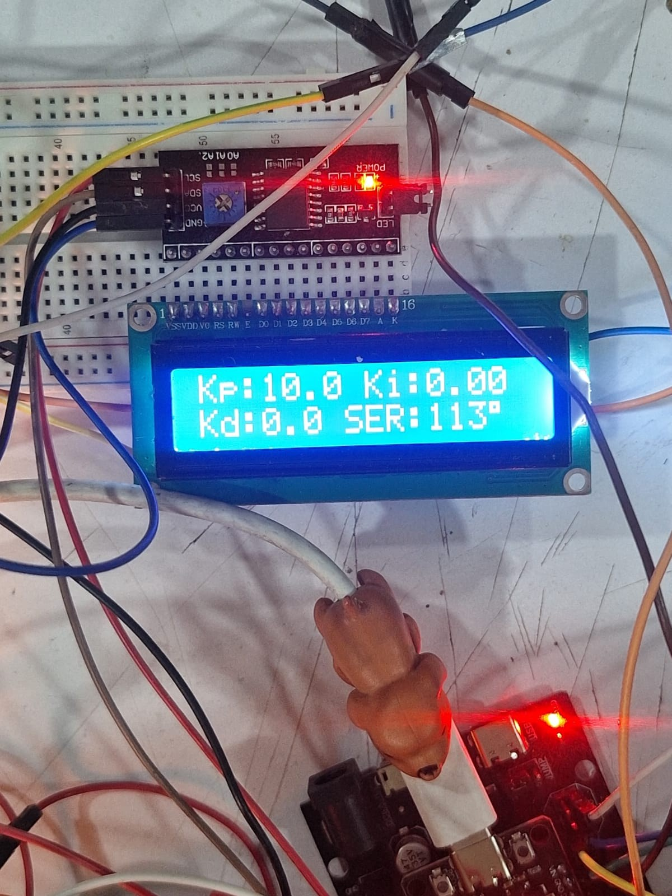

# Práctica 9: Control PID de temperatura

Control **PID** de temperatura con un **ESP32**:

- un sensor **DS18B20** mide la temperatura;
- con un **teclado 4x4** se fijan el setpoint (SP, de 35 a 40 °C) y las ganancias Kp, Ki y Kd;
- una **LCD I2C** muestra las variables;
- un **servo** gira la perilla de un **dimmer**, que regula la potencia de un foco de 100 W (calienta);
- un **módulo de relevadores** maneja la **celda Peltier** (enfría) y el **extractor**.

Es la práctica 8 con las acciones **integral** y **derivativa** agregadas.

## Funcionamiento

Cada segundo (Ts = 1 s) el ESP32 calcula:

$$e[k] = SP - T[k] \qquad e_{\%}[k] = \frac{e[k]}{SP} \cdot 100$$

$$P[k] = K_p \, e[k] \qquad I[k] = I[k-1] + K_i \, e[k] \, T_s \qquad D[k] = -K_d \, \frac{T[k] - T[k-1]}{T_s}$$

$$u[k] = P[k] + I[k] + D[k], \quad \text{limitada de 0 a 100 \%}$$

- **P (proporcional):** reacciona al tamaño del error.
- **I (integral):** acumula el error y elimina el que queda en estado estable con un control P solo.
- **D (derivativa):** frena el cambio de temperatura y reduce el sobreimpulso. Se calcula sobre la temperatura medida y no sobre el error, para que un cambio de SP no produzca un salto en la salida.
- **Anti-windup:** cuando la salida está saturada (0 o 100 %), la integral deja de acumularse en ese sentido. Así no se "carga" de más mientras el foco ya está al máximo.

La salida se convierte en un ángulo para el servo, igual que en la práctica 8:

$$\theta = 90° + \frac{u}{100}(180° - 90°)$$

### Peltier y extractor

Funcionan igual que en la práctica 8:

| Relevador | Cuándo se enciende |
|---|---|
| **Extractor** | Siempre, mientras el sistema está funcionando |
| **Peltier** | Solo cuando hay que enfriar: se enciende si T ≥ SP + 0.5 °C y se apaga cuando T baja al SP |

Mientras la Peltier enfría, el foco se queda al mínimo (servo en 90°). El PID sube o baja la potencia del foco, y la Peltier solo entra si la temperatura se pasa de la referencia.

**Seguridad:**
- si el DS18B20 falla, el foco queda al mínimo, la Peltier se apaga y la integral se reinicia;
- arriba de 60 °C, el foco se apaga y se enciende la Peltier.

### Teclado

| Tecla | Función |
|---|---|
| **A** | Capturar el setpoint (35 a 40 °C) |
| **B** | Capturar Kp (0 a 100) |
| **C** | Capturar Ki (0 a 10) |
| **D** | Capturar Kd (0 a 200) |
| **0–9** | Escribir el valor |
| **\*** | Punto decimal al capturar. **Sin capturar, cambia de pantalla** |
| **#** | Confirmar. Si no escribiste nada, cancela |

Ejemplo: `A 3 8 #` → SP = 38 °C · `C 0 * 8 #` → Ki = 0.8.

### Pantalla LCD

Con la tecla **\*** se cambia entre tres pantallas:

```
Pantalla 1         Pantalla 2         Pantalla 3
T:37.9° SP:38.0°   Kp:12.0 Ki:0.80    Peltier:   OFF
E:0.3% OUT:27%     Kd:2.0 SER:114°    Extractor: ON
```

- **T / SP:** temperatura actual y de referencia.
- **E:** error en porcentaje del SP.
- **OUT:** porcentaje de potencia del foco.
- **Kp, Ki, Kd:** ganancias del PID.
- **SER:** grados del servo.
- **Peltier / Extractor:** estado de los relevadores.

### Monitor serie

A 115200 baudios imprime cada segundo `t, T, SP, error, error_pct, P, I, D, salida, angulo, peltier`. Con estos datos puedes graficar la respuesta y medir el tiempo de establecimiento, el sobreimpulso y el error en estado estable.

## Ajuste de las ganancias

1. Empieza con **Ki = 0** y **Kd = 0**, y sube Kp hasta que la respuesta sea rápida sin oscilar demasiado.
2. Agrega **Ki** poco a poco para eliminar el error en estado estable.
3. Agrega **Kd** si hay mucho sobreimpulso.

| Parámetro | Efecto | Si es demasiado alto |
|---|---|---|
| Kp | Respuesta al error | Oscilaciones y sobreimpulso |
| Ki | Elimina el error acumulado | Sobreimpulso y oscilaciones |
| Kd | Frena los cambios rápidos | Sensible al ruido del sensor |

Los valores iniciales del código (Kp = 12, Ki = 0.8, Kd = 2) son solo un punto de partida. El ajuste depende de tu caja, del foco y del dimmer.

## Componentes

- ESP32 DevKit V1 (30 pines)
- Sensor DS18B20 (sonda) y resistencia de 4.7 kΩ
- Teclado matricial 4x4
- Pantalla LCD 16x2 con módulo I2C (0x27)
- Servomotor SG90 o de más torque
- Dimmer compatible con el foco
- Foco de 100 W con soquet
- Módulo de relevadores de 5 V (activo en bajo)
- Celda Peltier TEC1-12706 con disipador y ventilador
- Extractor de 12 V
- Fuente de 12 V para la Peltier y el extractor
- Fuente de 5 V (mínimo 1 A) para el servo

## Conexiones

Son las mismas que en la práctica 8.

| Componente | Pin | ESP32 |
|---|---|---|
| DS18B20 | DATA (con 4.7 kΩ a VCC) | GPIO 4 |
| DS18B20 | VCC / GND | 3.3V / GND |
| Teclado | R1, R2, R3, R4 | GPIO 19, 23, 16, 17 |
| Teclado | C1, C2, C3, C4 | GPIO 26, 25, 33, 32 |
| LCD I2C | SDA / SCL | GPIO 21 / GPIO 22 |
| LCD I2C | VCC / GND | 5V / GND |
| Servo | Señal | GPIO 18 |
| Servo | V+ / GND | Fuente de 5 V / GND común |
| Relevador Peltier | IN | GPIO 27 |
| Relevador extractor | IN | GPIO 13 |
| Módulo de relevadores | VCC / GND | 5V / GND |
| Relevadores | COM / NO | +12 V / + de la Peltier y + del extractor |



## Prototipo

<p align="center">
   
</p>

## Estructura

```
practica9_control_pid/
├── src/main.cpp          Código del programa
├── platformio.ini        Configuración de PlatformIO
├── diagram.json          Circuito para el simulador Wokwi
├── wokwi.toml            Configuración de Wokwi
├── libraries.txt         Librerías para Wokwi
├── img/                  Diagrama de conexiones y fotos del prototipo
└── doc/                  Reporte de la práctica
```

## Cómo compilar y cargar

**PlatformIO (VS Code):** abre esta carpeta, compila con *Build* y carga con *Upload*.

**Arduino IDE:** usa el archivo `.ino`, instala las librerías **LiquidCrystal I2C**, **Keypad**, **OneWire**, **DallasTemperature** y **ESP32Servo**, y selecciona la placa **ESP32 Dev Module**.

**Simulación en Wokwi:** haz clic en el DS18B20 para cambiar la temperatura. No hay dimmer ni foco: solo se ve el movimiento del servo. Los relevadores se representan con LEDs, el azul para la Peltier y el verde para el extractor.

## Notas

- **Calibra** `ANGULO_MIN` (90°) y `ANGULO_MAX` (180°) según el recorrido real de la perilla del dimmer.
- **Relevadores:** el código supone un módulo activo en bajo. Si encienden al revés, intercambia `LOW` y `HIGH` en `RELE_ON` y `RELE_OFF`.
- **¡120 V!** El servo solo gira la perilla, no toca los terminales del dimmer. No dejes el foco encendido sin supervisión.
