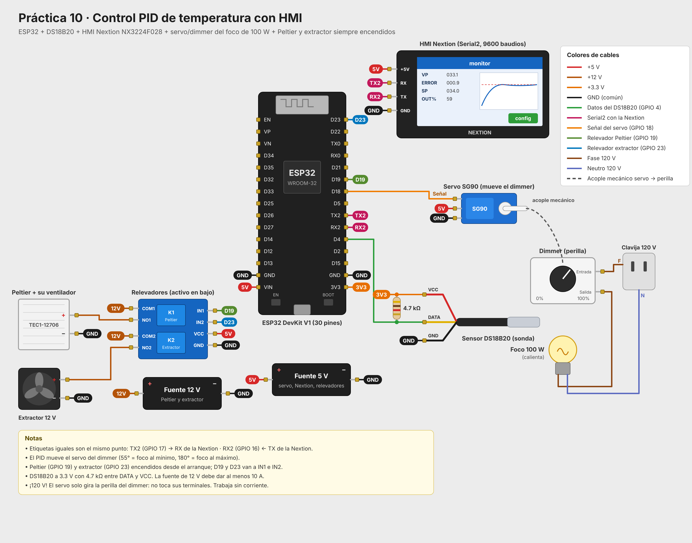
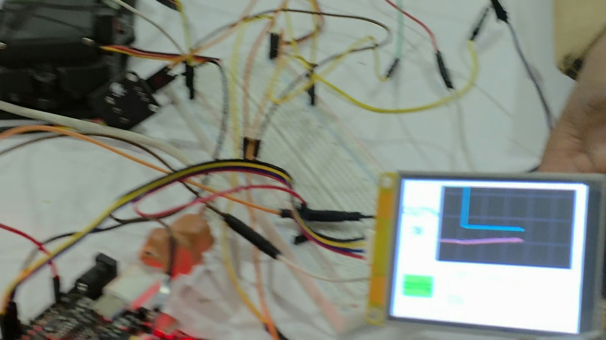
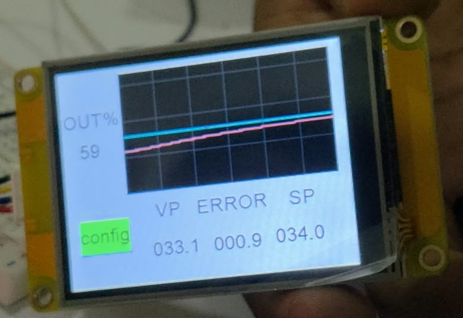

# Práctica 10: Control PID de temperatura con HMI (proyecto final)

Control **PID** de temperatura con un **ESP32** y una pantalla táctil **Nextion NX3224F028**, que sustituye a la LCD y al teclado de la práctica 9:

- un sensor **DS18B20** mide la temperatura;
- un **servo** gira la perilla de un **dimmer**, que regula la potencia de un foco de 100 W (calienta);
- la **celda Peltier** y el **extractor** van con relevador y están **siempre encendidos**, sacando calor de la caja;
- la **HMI** muestra VP, SP, error, salida y la gráfica de temperatura, y permite cambiar SP, Kp, Ki y Kd.

## Funcionamiento

Cada segundo el ESP32:

1. Lee el DS18B20 sin bloquear: pide la conversión y la lee 800 ms después.
2. Calcula el error **e = SP − T** y el PID:
   - P = Kp · e
   - I = I + Ki · e · Ts, con anti-windup por integración condicional, limitada de 0 a 100
   - D = −Kd · (T − T anterior) / Ts, derivada sobre la medición
3. Limita la salida **u** de 0 a 100 % y la convierte en ángulo del servo:

   $$\theta = 55° + \frac{u}{100}(180° - 55°)$$

4. Manda los valores y un punto de la gráfica a la Nextion.
5. Imprime por el monitor serie (115200) `t_s, SP, T, E, P, I, D, U, Servo`.

Como la Peltier y el extractor no se apagan, el PID solo regula el foco. Si la temperatura está abajo del SP, sube la potencia; si está arriba, la baja y la Peltier enfría.

**Configuración guardada:** SP, Kp, Ki y Kd se guardan en la memoria flash (`Preferences`) y se recuperan al reiniciar.

**Seguridad:**
- si el DS18B20 falla, el foco se va al mínimo y la HMI muestra `ERROR SENSOR`;
- a 80 °C el foco se apaga hasta que la temperatura baje 2 °C, y la HMI muestra `SOBRETEMP`.

## HMI Nextion

Comunicación por **Serial2 a 9600 baudios**. El valor debe coincidir con `baud=` en el `Program.s` del Nextion Editor.

### Página `monitor`

| Componente | Tipo | Contenido |
|---|---|---|
| `x_vp` | Xfloat | Temperatura actual (valor × 10) |
| `x_sp` | Xfloat | Setpoint (valor × 10) |
| `x_err` | Xfloat | Error SP − VP en °C (valor × 10) |
| `n_out` | Number | Salida del controlador (%) |
| `w_graf` | Waveform, **id 8**, alto 135 px | Canal 0: temperatura · canal 1: SP · escala de 20 a 50 °C |
| `t_estado` | Text (opcional) | `OK`, `ERROR SENSOR` o `SOBRETEMP` |
| `config` | Button | Cambia a la página `config` |

Al entrar a la página, la Nextion manda el byte `0x52` (`printh 52`) y el ESP32 redibuja la gráfica con los últimos 120 puntos.

### Página `config`

| Componente | Contenido |
|---|---|
| `cx_sp` | SP (valor × 10), hasta 75 °C |
| `cx_kp` | Kp (valor × 10), hasta 100 |
| `cx_ki` | Ki (valor × 100), hasta 10 |
| `cx_kd` | Kd (valor × 10), hasta 100 |
| Aplicar | Manda los cuatro valores al ESP32 |

El botón Aplicar manda `0x55` seguido de los cuatro valores como enteros de 32 bits, por ejemplo:

```
printh 55
prints cx_sp.val,4
prints cx_kp.val,4
prints cx_ki.val,4
prints cx_kd.val,4
```

Al recibirlos, el ESP32 los limita a su rango, reinicia la integral, los guarda en la flash e imprime `APLICADO -> ...` en el monitor serie.

## Componentes

- ESP32 DevKit V1 (30 pines)
- Pantalla Nextion NX3224F028 (2.8", táctil)
- Sensor DS18B20 (sonda) y resistencia de 4.7 kΩ
- Servomotor
- Dimmer y foco de 100 W
- Módulo de relevadores de 5 V (activo en bajo)
- Celda Peltier TEC1-12706 con disipador y ventilador
- Extractor de 12 V
- Fuente de 12 V para la Peltier y el extractor
- Fuente de 5 V para el servo y la Nextion

## Conexiones

| Componente | Pin | ESP32 |
|---|---|---|
| DS18B20 | DATA (con 4.7 kΩ a 3.3 V) | GPIO 4 |
| Servo | Señal | GPIO 18 |
| Relevador Peltier (+ su ventilador) | IN1 | GPIO 19 |
| Relevador extractor | IN2 | GPIO 23 |
| Nextion | TX | GPIO 16 (RX2) |
| Nextion | RX | GPIO 17 (TX2) |
| Nextion, servo, relevadores | 5V / GND | Fuente de 5 V / GND común |



## Prototipo

<p align="center">
   
</p>

Video del funcionamiento de la gráfica con el PID: [carpeta de Google Drive](https://drive.google.com/drive/folders/15vL7n2dxbo3m-eaWvgcIYH7tPbeihD_d)

## Estructura

```
practica10_pid_hmi/
├── src/main.cpp          Código del programa
├── platformio.ini        Configuración de PlatformIO
├── diagram.json          Circuito para el simulador Wokwi
├── wokwi.toml            Configuración de Wokwi
├── libraries.txt         Librerías para Wokwi
├── img/                  Diagrama de conexiones y fotos del prototipo
└── doc/                  Reporte de la práctica
```

## Cómo compilar y cargar

**PlatformIO (VS Code):** abre esta carpeta, compila con *Build* y carga con *Upload*.

**Arduino IDE:** usa el archivo `.ino`. Instala **OneWire**, **DallasTemperature** y **ESP32Servo**, y selecciona la placa **ESP32 Dev Module**. `Preferences` ya viene con el núcleo del ESP32.

**Wokwi:** no tiene Nextion, así que solo se ven el servo y los relevadores (LED azul = Peltier, LED verde = extractor) y los datos en el monitor serie.

## Notas

- **Si la HMI no se actualiza:**
  - revisa que los baudios coincidan;
  - revisa que TX y RX estén cruzados y que haya GND común;
  - revisa que los nombres e id de los componentes sean exactamente los de las tablas.
- **Calibra el dimmer** con `ANGULO_MIN` (55°) y `ANGULO_MAX` (180°) según el recorrido de la perilla.
- **Relevadores:** el código supone un módulo activo en bajo. Si funcionan al revés, cambia `RELAY_ACTIVO` a `HIGH`.
- **¡120 V!** El servo solo gira la perilla del dimmer, no toca sus terminales.
