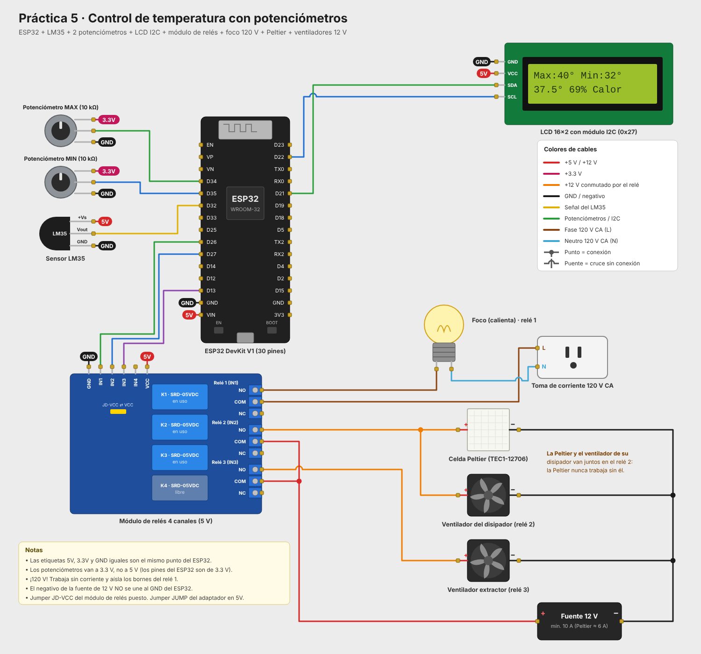
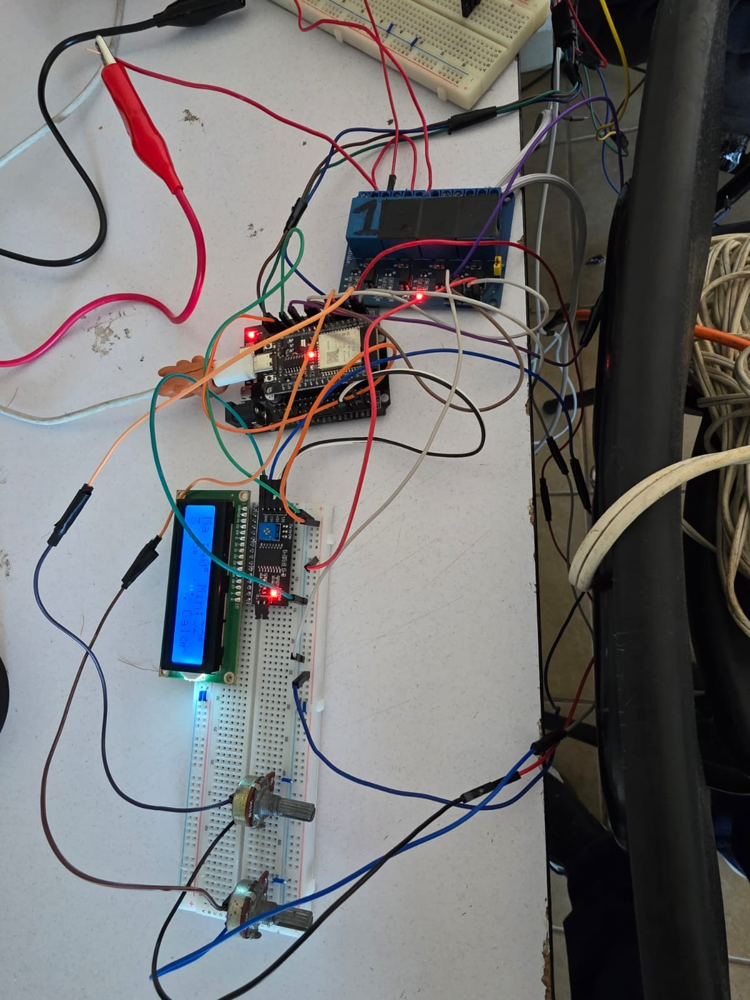
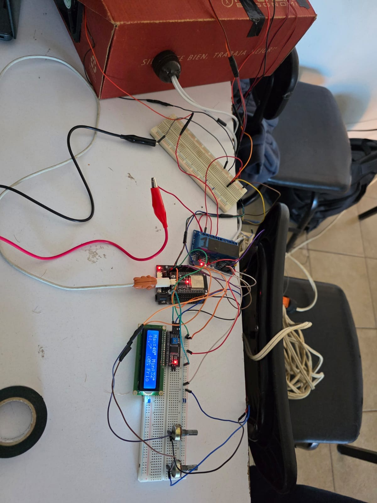
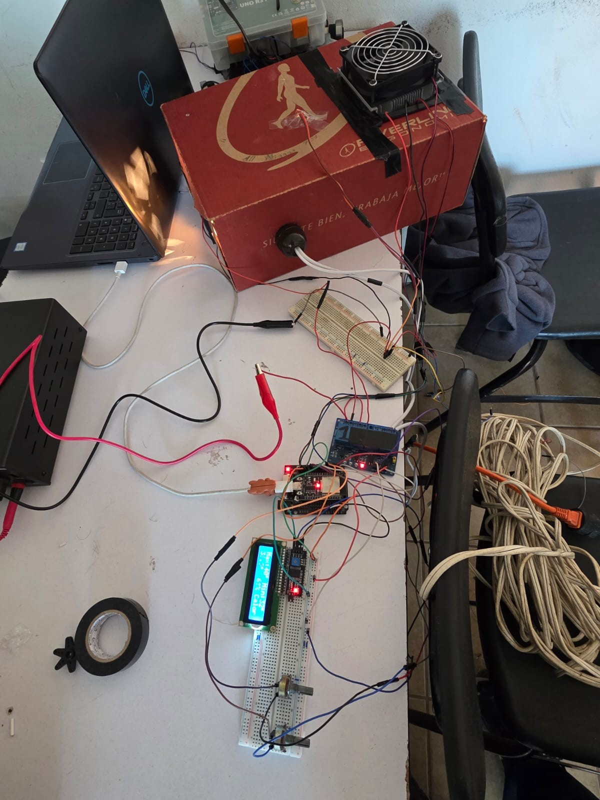
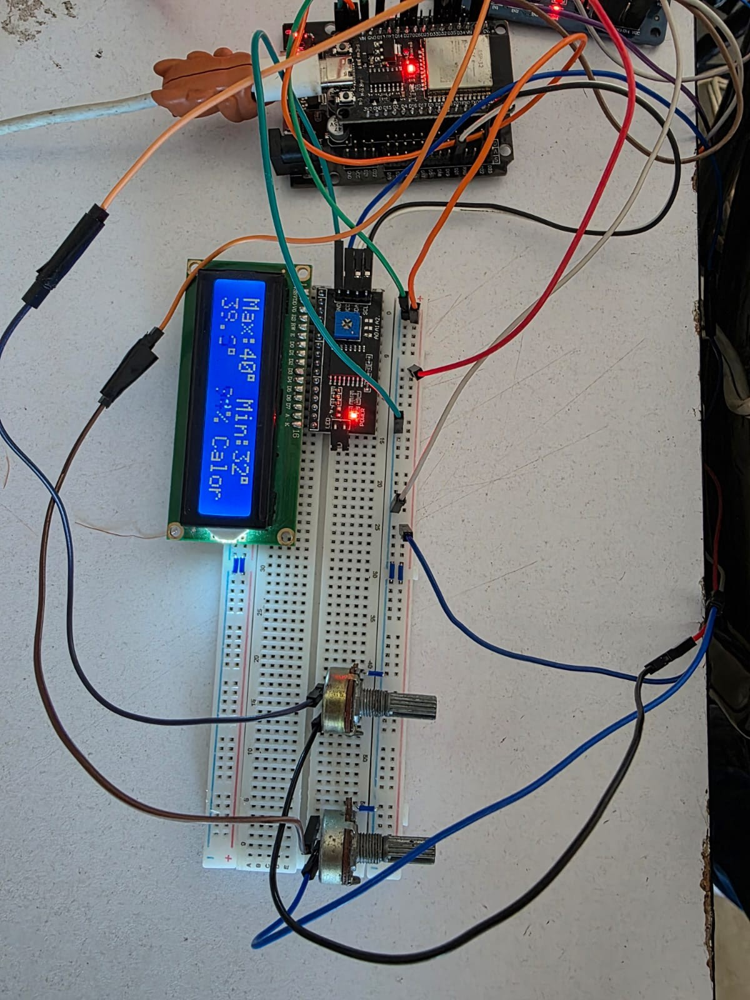

# Práctica 5: Control ON-OFF de temperatura con potenciómetros

Versión de la práctica 3 en la que la temperatura máxima y la mínima se ajustan con **dos potenciómetros** en lugar de botones, y el sensor DS18B20 se sustituye por un **LM35** analógico. Un foco calienta la caja y una celda Peltier la enfría.

## Funcionamiento

1. **Calentando:** el foco (relé 1) está encendido hasta que la temperatura llega al **máximo**.
2. Al llegar al máximo se apaga el foco y se encienden la **celda Peltier con su ventilador** (relé 2) y el **extractor** (relé 3).
3. **Enfriando:** la Peltier y el extractor trabajan hasta que la temperatura baja al **mínimo**.
4. Al llegar al mínimo vuelve a encender el foco, y el ciclo se repite.

Además:

- El foco y la Peltier nunca están encendidos al mismo tiempo. Al cambiar de uno a otro hay una pausa de 1 s con ambos apagados.
- El extractor solo trabaja durante el enfriamiento.
- Si la salida del LM35 pasa de 1.5 V (falla de conexión), se apagan el foco y la Peltier, y la LCD muestra `Error LM35`.

### Potenciómetros

| Potenciómetro | Ajusta | Rango de la perilla |
|---|---|---|
| MAX | Temperatura máxima | 25 °C a 80 °C |
| MIN | Temperatura mínima | 20 °C a 75 °C |

El mínimo siempre queda al menos 5 °C por debajo del máximo. Cada potenciómetro se lee promediando 16 muestras, y el valor solo cambia cuando la perilla se mueve lo suficiente. La lectura del LM35 se suaviza con un promedio móvil de 5 muestras tomadas cada 100 ms.

### Pantalla LCD

```
Max:40° Min:32°
37.5°  69% Calor
```

La segunda fila muestra la temperatura actual, el porcentaje (posición entre el mínimo y el máximo) y el estado (`Calor` o `Frio`).

## Componentes

- ESP32 DevKit V1 (30 pines) con base de expansión
- Sensor de temperatura LM35
- 2 potenciómetros de 10 kΩ
- Pantalla LCD 16x2 con módulo I2C (dirección 0x27)
- Módulo de relés de 4 canales (5 V, activo en bajo)
- Foco con soquet (120 V)
- Celda Peltier TEC1-12706 con disipador y ventiladores
- Ventilador extractor
- Fuente de 12 V

## Conexiones

| Componente | Pin | ESP32 |
|---|---|---|
| LM35 | VOUT | GPIO 32 |
| LM35 | VCC / GND | 5V (VIN) / GND |
| Potenciómetro MAX | Terminal central | GPIO 34 |
| Potenciómetro MIN | Terminal central | GPIO 35 |
| Potenciómetros | Extremos | **3.3V** / GND |
| Relé 1 (foco) | IN1 | GPIO 26 |
| Relé 2 (Peltier + ventilador) | IN2 | GPIO 27 |
| Relé 3 (extractor) | IN3 | GPIO 13 |
| LCD I2C | SDA / SCL | GPIO 21 / GPIO 22 |
| LCD I2C | VCC / GND | 5V (VIN) / GND |

El lado de potencia es igual al de la práctica 3: la fase de 120 V pasa por el relé 1 hacia el foco, y el +12 V va al COM de los relés 2 y 3.



## Prototipo

| | |
|---|---|
|  |  |
|  |  |

## Estructura

```
practica5_temperatura_potenciometros/
├── src/main.cpp          Código del programa
├── platformio.ini        Configuración de PlatformIO
├── diagram.json          Circuito para el simulador Wokwi
├── wokwi.toml            Configuración de Wokwi
├── libraries.txt         Librerías para Wokwi
├── img/                  Diagrama de conexiones y fotos del prototipo
└── doc/                  Reporte de la práctica
```

## Cómo compilar y cargar

**PlatformIO (VS Code):** abre esta carpeta, compila con *Build* y carga con *Upload*. El monitor serie trabaja a 115200 baudios.

**Arduino IDE:** copia el contenido de `src/main.cpp` a un sketch `.ino`, instala la librería **LiquidCrystal I2C** (Frank de Brabander) y selecciona la placa **ESP32 Dev Module**.

**Simulación en Wokwi:** compila con PlatformIO y abre el simulador desde la extensión de Wokwi. Wokwi no tiene LM35, así que se simula con un potenciómetro (`lm35_simulado`): 0.30 V equivalen a 30 °C. El foco, la Peltier y el extractor se representan con LEDs.

## Notas

- Los potenciómetros van a **3.3 V, no a 5 V**: los pines del ESP32 solo aguantan 3.3 V.
- Las lecturas del LM35 son menos precisas que las del DS18B20 y cambian de forma más brusca, porque su señal es analógica.
- El foco trabaja a **120 V**. Haz las conexiones sin corriente y aísla los bornes del relé 1.
- El negativo de la fuente de 12 V no se une al GND del ESP32.
- Conecta el GND del LM35 y el del módulo de relés a pines GND distintos del ESP32: si comparten línea, la corriente de las bobinas altera la lectura del sensor.
