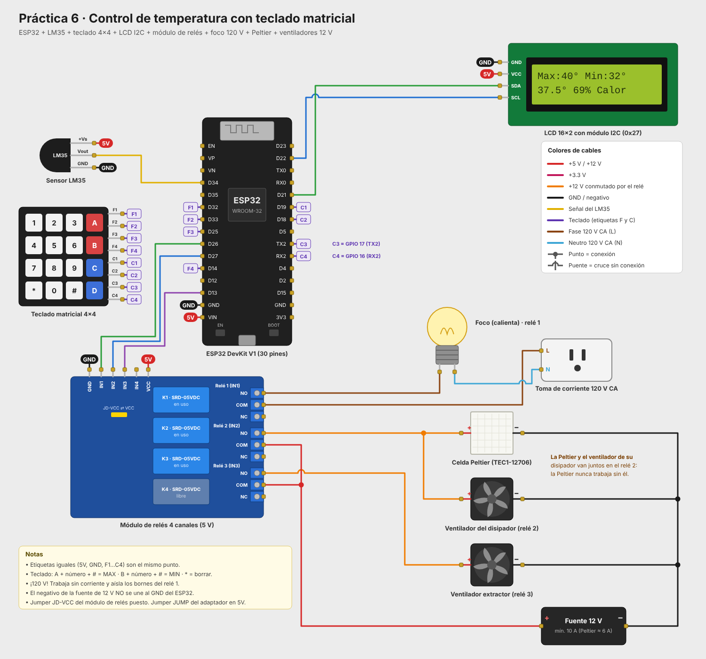
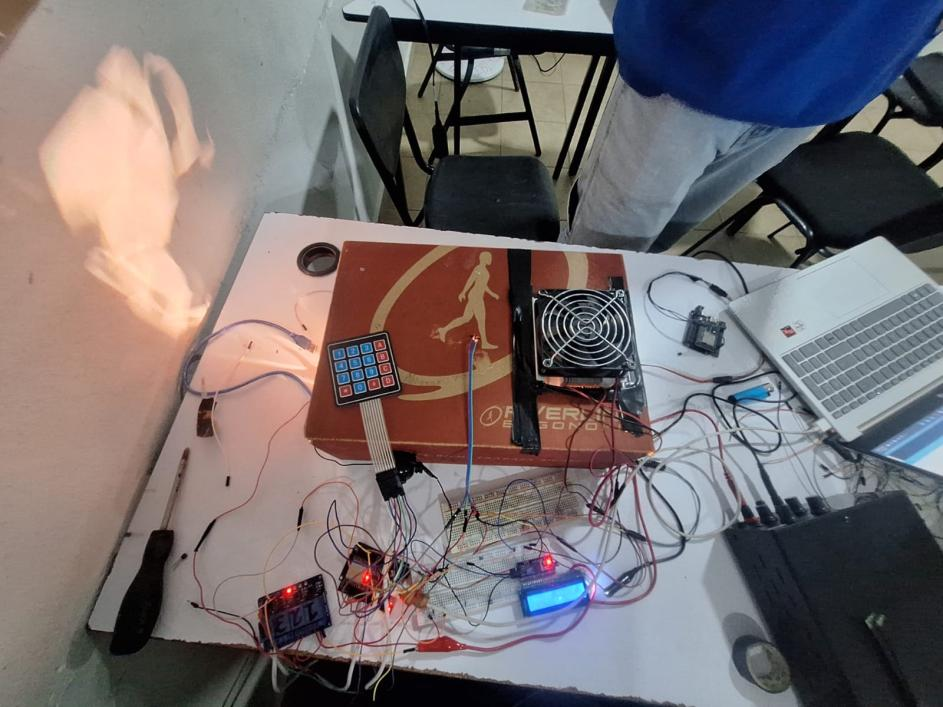
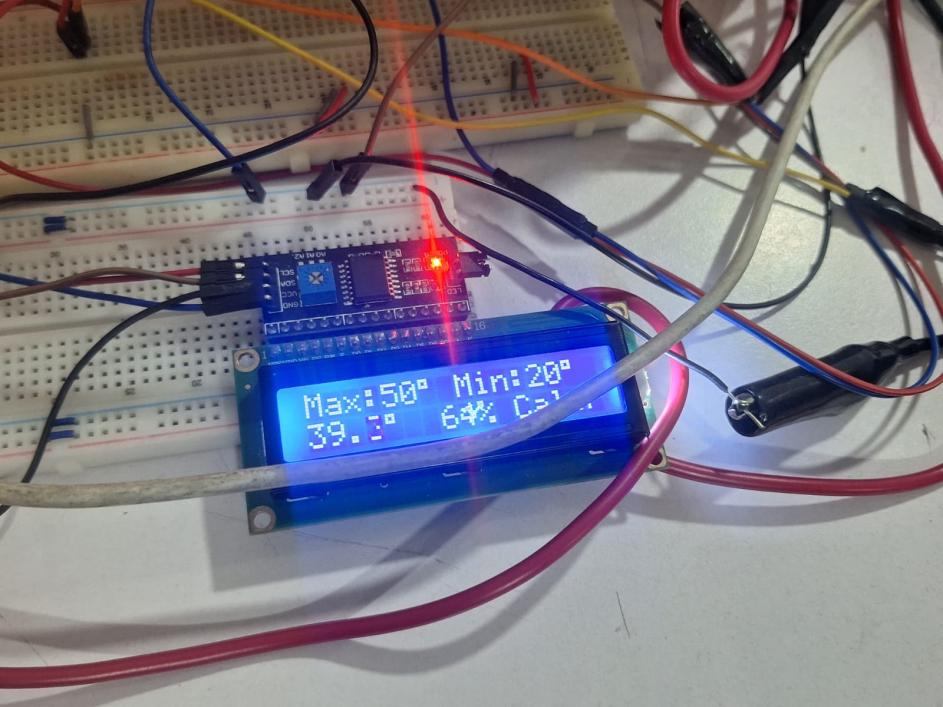

# Práctica 6: Control ON-OFF de temperatura con teclado matricial

Versión del control de temperatura en la que la temperatura máxima y la mínima se escriben con un **teclado matricial 4x4**. La temperatura se mide con un sensor **LM35**, un foco calienta la caja y una celda Peltier la enfría.

## Uso del teclado

| Teclas | Resultado |
|---|---|
| **A**, número, **#** | Fija la temperatura máxima. Ejemplo: `A 4 0 #` → máximo de 40 °C. |
| **B**, número, **#** | Fija la temperatura mínima. Ejemplo: `B 3 2 #` → mínimo de 32 °C. |
| **\*** | Borra el último dígito. Si no hay dígitos, cancela la captura. |

- Se aceptan valores de 0 a 99 °C, con uno o dos dígitos.
- El máximo debe quedar al menos 5 °C arriba del mínimo. Si no se cumple, la LCD avisa y se conserva el valor anterior.
- Si no se presiona nada durante 10 s, la captura se cancela sola.
- Los valores se guardan en la memoria del ESP32 (`Preferences`) y se conservan aunque se vaya la luz.
- El control sigue funcionando mientras se escribe un valor.

## Funcionamiento del control

1. **Calentando:** el foco (relé 1) está encendido hasta que la temperatura llega al **máximo**.
2. Al llegar al máximo se apaga el foco y se encienden la **celda Peltier con su ventilador** (relé 2) y el **extractor** (relé 3).
3. **Enfriando:** la Peltier y el extractor trabajan hasta que la temperatura baja al **mínimo**.
4. Al llegar al mínimo vuelve a encender el foco, y el ciclo se repite.

Además:

- El foco y la Peltier nunca están encendidos al mismo tiempo. Al cambiar de uno a otro hay una pausa de 1 s con ambos apagados.
- Si la salida del LM35 pasa de 1.5 V (falla de conexión), se apagan el foco y la Peltier, y la LCD muestra `Error LM35`.
- La lectura del LM35 se suaviza con un promedio móvil de 5 muestras tomadas cada 100 ms.

### Pantalla LCD

```
Normal:              Mientras escribes:      Al confirmar:
Max:40° Min:32°      Nuevo MAX: 45_          MAX = 45°
37.5°  69% Calor     #:OK  *:Borrar          Guardado
```

## Componentes

- ESP32 DevKit V1 (30 pines) con base de expansión
- Sensor de temperatura LM35
- Teclado matricial 4x4
- Pantalla LCD 16x2 con módulo I2C (dirección 0x27)
- Módulo de relés de 4 canales (5 V, activo en bajo)
- Foco con soquet (120 V)
- Celda Peltier TEC1-12706 con disipador y ventiladores
- Ventilador extractor
- Fuente de 12 V

## Conexiones

| Componente | Pin | ESP32 |
|---|---|---|
| Teclado F1, F2, F3, F4 | Filas | GPIO 32, 33, 25, 14 |
| Teclado C1, C2, C3, C4 | Columnas | GPIO 19, 18, 17, 16 |
| LM35 | VOUT | GPIO 34 |
| LM35 | VCC / GND | 5V (VIN) / GND |
| Relé 1 (foco) | IN1 | GPIO 26 |
| Relé 2 (Peltier + ventilador) | IN2 | GPIO 27 |
| Relé 3 (extractor) | IN3 | GPIO 13 |
| LCD I2C | SDA / SCL | GPIO 21 / GPIO 22 |
| LCD I2C | VCC / GND | 5V (VIN) / GND |

Los pines del teclado se cuentan de izquierda a derecha viéndolo de frente. Si al presionar una tecla aparece otra, invierte el orden de `pinesFilas` o `pinesColumnas` en el código.



## Prototipo

| | |
|---|---|
|  |  |

## Estructura

```
practica6_temperatura_teclado/
├── src/main.cpp          Código del programa
├── platformio.ini        Configuración de PlatformIO
├── diagram.json          Circuito para el simulador Wokwi
├── wokwi.toml            Configuración de Wokwi
├── libraries.txt         Librerías para Wokwi
├── img/                  Diagrama de conexiones y fotos del prototipo
└── doc/                  Reporte de la práctica
```

## Cómo compilar y cargar

**PlatformIO (VS Code):** abre esta carpeta, compila con *Build* y carga con *Upload*. Las librerías se descargan solas desde `platformio.ini`. El monitor serie trabaja a 115200 baudios.

**Arduino IDE:** copia el contenido de `src/main.cpp` a un sketch `.ino` e instala las librerías **Keypad** (Mark Stanley, Alexander Brevig) y **LiquidCrystal I2C** (Frank de Brabander). Selecciona la placa **ESP32 Dev Module**.

**Simulación en Wokwi:** compila con PlatformIO y abre el simulador desde la extensión de Wokwi. Wokwi no tiene LM35, así que se simula con un potenciómetro (`lm35_simulado`): 0.30 V equivalen a 30 °C. El foco, la Peltier y el extractor se representan con LEDs.

## Notas

- El foco trabaja a **120 V**. Haz las conexiones sin corriente y aísla los bornes del relé 1.
- El negativo de la fuente de 12 V no se une al GND del ESP32.
- Conecta el GND del LM35 y el del módulo de relés a pines GND distintos del ESP32: si comparten línea, la corriente de las bobinas altera la lectura del sensor.
