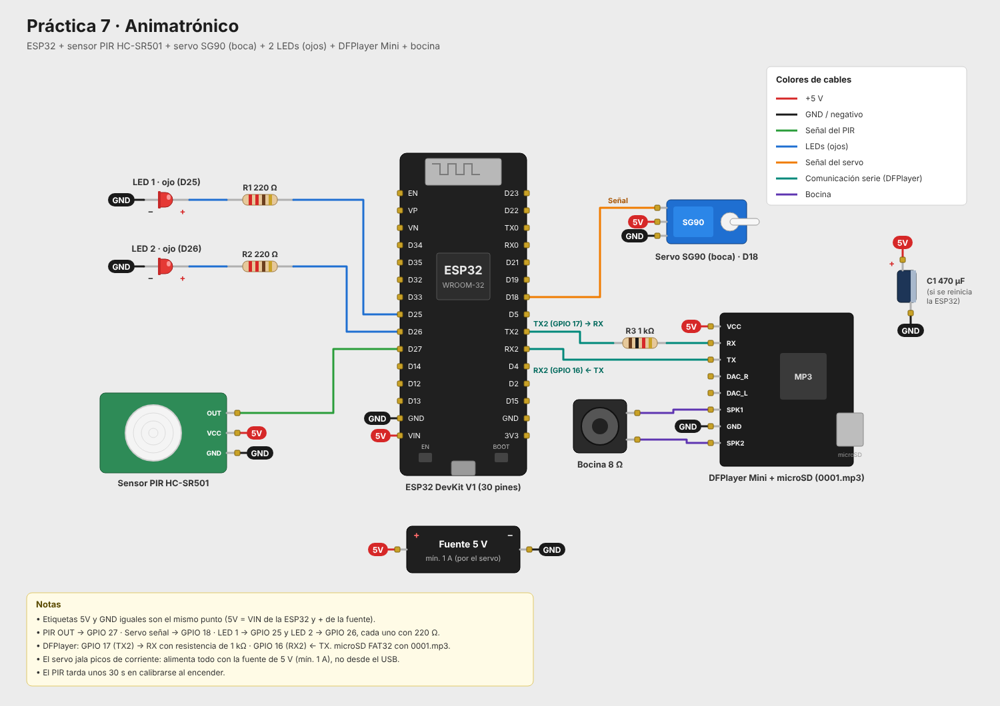
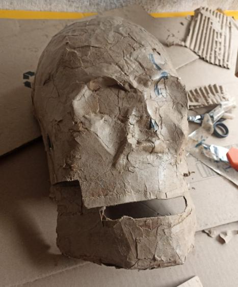
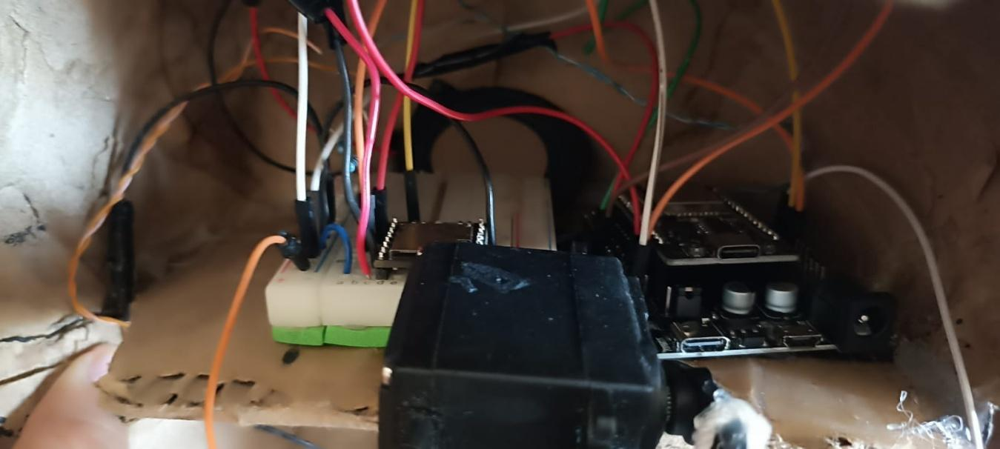
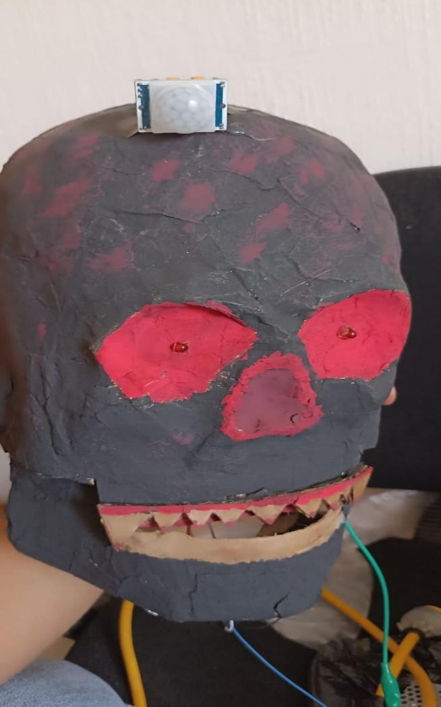

# Práctica 7: Animatrónico

Calavera animatrónica controlada por un **ESP32**. Un sensor **PIR HC-SR501** detecta movimiento y entonces, al mismo tiempo:

- el **DFPlayer Mini** reproduce un audio desde la microSD por una bocina;
- los **dos LEDs** (los ojos) se encienden;
- un **servo SG90** abre y cierra la mandíbula.

## Funcionamiento

1. Al encender, el ESP32 inicia el DFPlayer y espera **30 s** a que el PIR se calibre.
2. En reposo, revisa el PIR cada 50 ms y solo reacciona cuando la señal pasa de LOW a HIGH, es decir, cuando hay un movimiento nuevo.
3. Al detectar movimiento empieza el show, que dura **8 s**:
   - suena la pista `0001.mp3`;
   - se encienden los ojos;
   - la boca se abre (50°) y se cierra (0°) cada 300 ms.
4. Al terminar, la boca se cierra, los ojos se apagan y el audio se detiene.
5. Antes de volver a detectar, espera a que el PIR se mantenga 1 s en LOW, con un máximo de 15 s. Así un mismo movimiento no repite el show.

### Ajustes en el código

| Constante | Valor | Qué controla |
|---|---|---|
| `ANGULO_CERRADO` / `ANGULO_ABIERTO` | 0° / 50° | Recorrido de la mandíbula |
| `VELOCIDAD_BOCA` | 300 ms | Tiempo de cada movimiento de la boca |
| `DURACION_SHOW` | 8000 ms | Duración de la animación |
| `VOLUMEN` | 10 | Volumen del DFPlayer (0 a 30) |
| `PISTA` | 1 | Archivo que se reproduce (`0001.mp3`) |
| `LEDS_SIEMPRE_ENCENDIDOS` | false | `true` deja los ojos encendidos todo el tiempo |

## Componentes

- ESP32 DevKit V1 (30 pines)
- Sensor PIR HC-SR501
- Servomotor SG90
- 2 LEDs rojos con resistencias de 220 Ω
- Módulo DFPlayer Mini con tarjeta microSD (FAT32)
- Bocina de 8 Ω
- Resistencia de 1 kΩ para la línea RX del DFPlayer
- Fuente de 5 V (mínimo 1 A)
- Capacitor de 470 µF (opcional, si el ESP32 se reinicia al mover el servo)

## Conexiones

| Componente | Pin | ESP32 |
|---|---|---|
| PIR | OUT | GPIO 27 |
| PIR | VCC / GND | 5V / GND |
| Servo | Señal | GPIO 18 |
| Servo | V+ / GND | 5V / GND |
| LED 1 (ojo) | Ánodo, con 220 Ω | GPIO 25 |
| LED 2 (ojo) | Ánodo, con 220 Ω | GPIO 26 |
| DFPlayer | RX, con 1 kΩ | GPIO 17 (TX2) |
| DFPlayer | TX | GPIO 16 (RX2) |
| DFPlayer | VCC / GND | 5V / GND |
| DFPlayer | SPK1 / SPK2 | Bocina |



## Prototipo

| | | |
|---|---|---|
|  |  |  |

## Estructura

```
practica7_animatronico/
├── src/main.cpp          Código del programa
├── platformio.ini        Configuración de PlatformIO
├── diagram.json          Circuito para el simulador Wokwi
├── wokwi.toml            Configuración de Wokwi
├── libraries.txt         Librerías para Wokwi
├── img/                  Diagrama de conexiones y fotos del prototipo
└── doc/                  Reporte de la práctica
```

## Cómo compilar y cargar

**PlatformIO (VS Code):** abre esta carpeta, compila con *Build* y carga con *Upload*. Las librerías se descargan solas desde `platformio.ini`. El monitor serie trabaja a 115200 baudios.

**Arduino IDE:** copia el contenido de `src/main.cpp` a un sketch `.ino` e instala las librerías **ESP32Servo** (Kevin Harrington) y **DFRobotDFPlayerMini** (DFRobot). Selecciona la placa **ESP32 Dev Module**.

**Simulación en Wokwi:** compila con PlatformIO y abre el simulador desde la extensión de Wokwi. Wokwi no tiene DFPlayer, así que el monitor serie avisará que no detecta el MP3, pero el PIR, el servo y los LEDs sí se pueden probar. Para disparar el PIR, haz clic en el sensor.

## Notas

- **Tarjeta microSD:** en formato FAT32, con el audio guardado como `0001.mp3`. `play(1)` reproduce el primer archivo que se copió a la tarjeta, así que es mejor dejar solo ese.
- **Resistencia de 1 kΩ:** la que va en la línea RX del DFPlayer reduce el ruido en la bocina.
- **Alimentación:** el servo jala picos de corriente. Aliméntalo desde la fuente de 5 V y no desde el USB del ESP32. Si el ESP32 se reinicia al mover la boca, pon el capacitor de 470 µF entre 5V y GND, cerca del servo.
- **Ajustes del PIR:** si se queda en HIGH demasiado tiempo, gira su potenciómetro de tiempo (Tx) al mínimo y revisa que el jumper esté en modo de disparo único (L).
